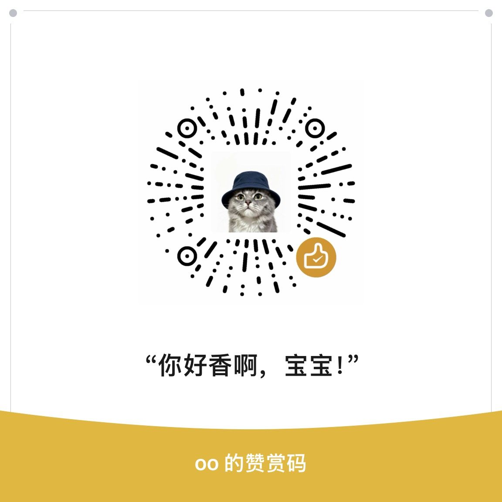

# 小小领航员 LittleNavigator

一个给 iRacing 中文玩家做的语音助手和中文 Spotter 语音包。

比赛时不方便低头找油量、圈速和前后车信息，小小领航员让你按住方向盘上的一个按钮，直接开口问即可。它在本机识别问题，读取 iRacing 遥测，再用同一套中文音色回答。语音包也可以单独装进 iRacing，不开助手照样能用。

但是一个人能想到的问法、能测试的方向盘和赛车都有限，能力也只够维护一个音色的语音包，所以希望中文社区里的玩家一起来补充这个开源项目。即便只是告诉我哪句话没听懂、哪条播报不对，或者提一句你比赛时真的会问的话，都很有帮助。

[下载最新版](https://github.com/xxushengcchen/LittleNavigator/releases/latest) · [反馈问题](https://github.com/xxushengcchen/LittleNavigator/issues) · [参与开发](CONTRIBUTING.md)

## 现在能做什么

- 按住键盘或方向盘按钮说话，松开后回答；可在设置中采集绑定。
- 查询油量、油耗、续航、比赛圈数和时间、名次、圈速、前后车、进站维修、天气和车辆状态。
- 查询全场第一名、赛道前车和后车的上一完整圈及最佳圈速。
- 本地 SenseVoice 识别，短语和意图匹配，离线语音播放。日常使用不需要大模型或语音 API Key。
- 自动记录没听明白的问法，便于后续补充。

v1.3.2 当前有 1,742 条问法、14 类遥测意图；助手合并语音资源有 2,937 条音频。语音数量和可回答的问题不是一回事：有些问题需要先读到有效遥测才能回答。

## 下载和安装助手

在 [Releases](https://github.com/xxushengcchen/LittleNavigator/releases) 下载 `LittleNavigator-1.3.2-Setup-x64.exe`。

1. 运行安装文件，自行选择安装位置。
2. 启动软件，在「设置 · 语音输入」选好麦克风，采集键盘或方向盘按钮。
3. 开启 iRacing。按住绑定按钮问一句，松开后等播报。

支持 Windows 10 2004 及以上、Windows 11 x64。安装文件约 562 MiB，含完整模型、语音及 WebView2 离线组件。没有 Python 环境也可以直接安装。

当前安装包未代码签名，Windows 可能显示未知发布者或 SmartScreen 提示。下载页附 `SHA256SUMS.txt`；请核对文件来源和校验值。

## 语音包单独装进 iRacing

只想换中文 Spotter、不需要语音问答，可以下载发布附件 `LittleNavigator-iRacing-VoicePack-v2.0.0.zip`。也可以从助手安装目录的 `build\pack\Mandarin-CNTW-Xusheng_Chen` 取出同一份语音包。

1. 退出 iRacing 模拟器，解压语音包。
2. 找到 **iRacing 游戏安装目录**下的 `sound\spcc`。默认安装通常是 `C:\Program Files (x86)\iRacing\sound\spcc`；Steam 或自选安装位置应使用实际游戏目录。
3. 将整个 `Mandarin-CNTW-Xusheng_Chen` 文件夹复制进去。确认结构如下，不要多套一层同名文件夹：

```text
iRacing/
└─ sound/
   └─ spcc/
      └─ Mandarin-CNTW-Xusheng_Chen/
         ├─ spmsg.txt
         ├─ SPCC_....WAV
         └─ ...
```

4. 进入模拟器的 **Options → Sound → Voice Pack**，选择 `Mandarin-CNTW-Xusheng_Chen`，并确认 Spotter 已开启。
5. 重新加载模拟器，让新语音包生效。如果列表里没有它，先检查路径和 `spmsg.txt` 是否直接位于语音包文件夹中。

这里使用的是游戏安装目录，不是 `文档\iRacing`。单独安装后，由 iRacing 触发原有 Spotter 播报；助手的按键提问功能仍需要启动小小领航员。`assistant-extra` 和 `assistant-telemetry` 是助手专用素材，不需要复制到游戏目录。

安装步骤依据 [iRacing 官方第三方语音包说明](https://support.iracing.com/support/solutions/articles/31000133521-using-third-party-spotter-packs) 和 [自定义语音包说明](https://support.iracing.com/support/solutions/articles/31000157884-creating-custom-spotter-packs)。

## 可以怎么问

| 内容 | 常用问法 |
|---|---|
| 燃油 | 目前还有多少油？油还能跑几圈？油够跑完吗？每圈油耗多少？ |
| 自己的圈速 | 我上一圈多少？最佳圈速多少？上一圈比最佳慢多少？ |
| 对手圈速 | 第一名圈速多少？前车上一圈多少？后车最佳圈速多少？ |
| 比赛进度 | 比赛还剩几圈？比赛还剩多久？我已经跑完几圈？ |
| 位置和前后车 | 现在第几名？同组第几名？前车多远？后车追上来了吗？ |
| 进站和维修 | 维修区限速多少？还剩几次快修？必修还剩多久？ |
| 天气 | 气温多少？路面温度多少？降雨强度多少？ |
| 车辆和设置 | 水温多少？油温多少？事故点多少？ABS 现在几档？ |

一次问一项最稳。第一名指全场第一名，前后车指赛道上的邻车，普通圈速问题默认问上一完整圈。

## 目前的限制

- 还不是自由聊天助手。现在主要靠短语和意图匹配，不是所有随口说的话都能理解。
- 没连上游戏、目标车辆没完成有效圈、缺少字段时，会说明拿不到数据，不拿另一项读数代替。
- 冷胎压是设定值；胎温和磨损来自有效进站检测，不能当成持续更新的实时胎面数据。
- 前后车秒差是估计值；事故点不能判断车损的具体部位。
- 某些设置和遥测字段与赛车有关，换车后可能无法读取。

## 接下来想做的事

这两项都还在计划中，当前版本没有上线，也没有定发布日期。

1. **增加一个可选的脏话版，并持续扩充语音数量。** 普通版继续保留。希望同一个场景能有更多自然的说法，也欢迎玩家一起写文案、指出不合适或听不清的播报。
2. **提供用户自行接入大模型 API 的接口。** 可以自己填写服务地址、API Key 和模型，让小小领航员能接话、追问，逐步接近和真人领航员交流的感觉。比赛数据仍以实际遥测为准；现有离线问答也会保留。当前配置里预留的 LLM 字段还没有接通可用的自由对话功能。

如果你愿意帮忙做接口、补中文口语、调试语音和方向盘支持，欢迎开 Issue 或 PR，一起讨论怎么做。

## 升级、配置和日志

升级前退出软件，运行新版安装文件，选择与旧版相同的安装范围和目录。安装版用户数据在 `%LOCALAPPDATA%\LittleNavigator`，升级和卸载都会保留。旧便携版可以在首次启动安装版前，把 `config.local.yaml` 复制到这个目录。

反馈识别问题时，最好写出原话、界面显示的识别文字、使用的版本和预期回答。需要日志时只提供相关片段，不要上传 API Key 或完整私人日志。

## 开发和参与

主要代码在 `voice-assistant/`：`src/` 负责识别、遥测、问答及播放，`app/` 是桌面窗口和界面，`tests/` 是回归测试，`packaging/` 是打包与安装脚本。`scripts/` 和 `content/` 放语音文案及生成工具。

开发环境使用 Windows、Python 3.12，模型和音频通过 Release 获取，不塞进 Git 历史。详细步骤见 [开发指南](DEVELOPMENT.md)，反馈和提交方式见 [贡献指南](CONTRIBUTING.md)。

代码采用 [MIT License](LICENSE)。预训练模型、第三方依赖、品牌标识和语音资源不自动适用本项目的 MIT 许可，保留各自来源和使用条件，见 [素材与依赖说明](THIRD_PARTY_NOTICES.md)。

制作：xushengchen from Moondrop-Dox Racing。项目由社区维护，不是 iRacing 官方软件。

## 赞赏

如果觉得我做得还不错，愿意支持一下的大佬，祝你irating早日破万，感谢支持。赞赏完全自愿，不影响使用；反馈问题、补文案、提 PR 也都欢迎。

<a href="assets/support.jpg"></a>
