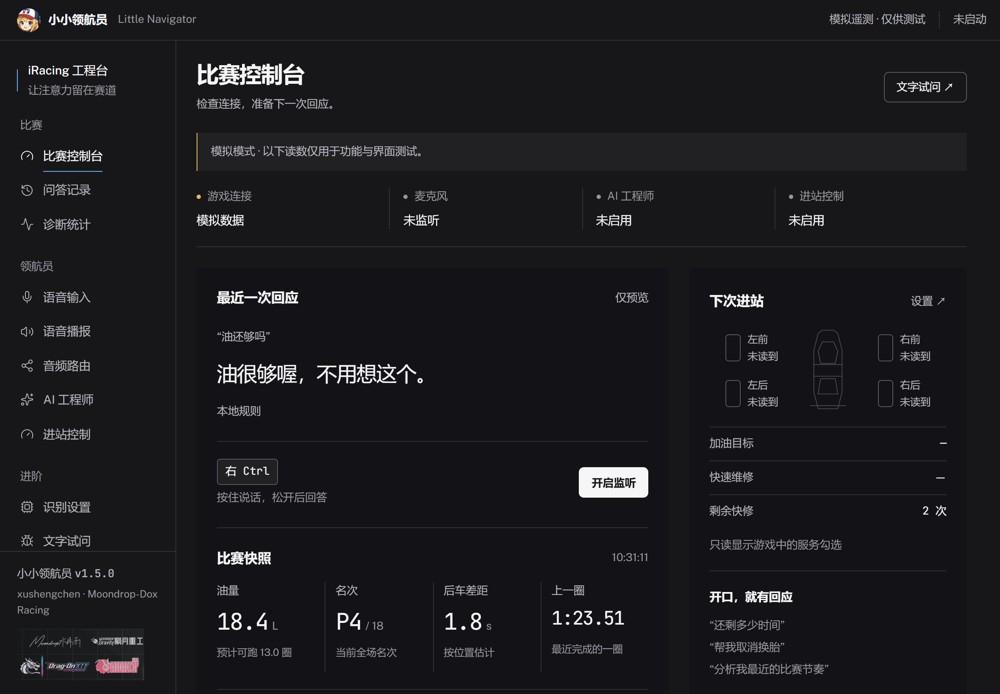
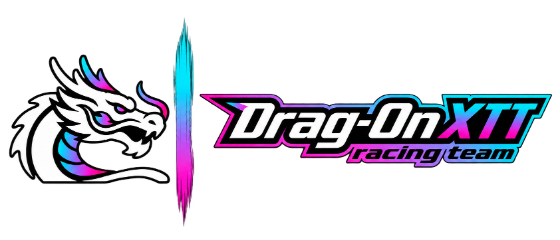

# 小小领航员 LittleNavigator

🏁 iRacing 中文语音助手与 Spotter 语音包。按住说话键问一句，松开后听中文回答——油量、剩余时间、名次、圈速、前后车、分段损失都能问。

Windows 10 2004+ / Windows 11 x64 · 本地规则问答不需要 API Key · [源码公开 · 个人非商业免费](LICENSE)

> **当前正式版 v1.6.1。** 从 v1.6.0 起，项目源码改用 PolyForm Noncommercial：个人、非商业用途免费，商业使用需另行取得[商业授权](COMMERCIAL-LICENSE.md)。v1.5.5 及更早版本仍按 MIT 授权。

[⬇️ 下载最新版](https://github.com/xxushengcchen/LittleNavigator/releases/latest) · [完整使用指南](docs/guide/user-guide.md) · [三步开始使用](#三步开始使用) · [反馈问题](https://github.com/xxushengcchen/LittleNavigator/issues)

## 这是什么

一个跑在你电脑上的 iRacing 副驾：

- **少找一次黑框。** 油量、剩余时间、名次、圈速、前后车距离，用中文问、中文答。
- **赛段损失也能问。** 哪一段慢、跟前车分段差多少，按官方分段报时间差。
- **日常问答留在本机。** 本地语音识别 + 规则匹配 + 录音播报，不接大模型也能用。
- **需要时再扩展。** AI 分析、AI 回答的语音合成、游戏内 Overlay、语音进站控制分别开关，**默认全部关闭**。
- **语音包可以单独用。** 只想要中文 Spotter？装上语音包由 iRacing 自己触发播报，不必启动助手。

## 三步开始使用

1. 到 [Releases](https://github.com/xxushengcchen/LittleNavigator/releases/latest) 下载 Windows 安装包（文件名以 `Setup-x64.exe` 结尾）并安装，**不需要装 Python**。
2. 打开软件，在「语音输入」里选麦克风、采集键盘或方向盘上的说话键，然后开启监听。
3. 进 iRacing，按住绑定键说「还剩多少时间」，松开等回答。

更新内容与升级说明见 [v1.6.1 版本说明](docs/releases/v1.6.1.md)。

## 可以这样问

| 想了解什么 | 试着说 |
| --- | --- |
| 燃油与续航 | 油还够吗；目前还有多少油；每圈油耗多少 |
| 比赛进度 | 还剩多少时间；比赛还剩几圈；我已经跑完几圈 |
| 圈速 | 我上一圈多少；最佳圈速多少；前车上一圈多少 |
| 位置与前后车 | 现在第几名；同组第几名；前车多远；后车多远 |
| 赛段与分段 | 我上一圈哪一段慢；第 2 段用了多少；跟前车分段差多少 |
| 维修与天气 | 还剩几次快修；必修还剩多久；气温多少；路面温度多少 |
| 进站服务（需先启用） | 帮我取消换胎；只换左侧轮胎；帮我加10升油；勾上快修 |

一次只问一个具体项目。全场第一名、赛道前后车、自己的车是三个不同对象；普通圈速问题默认读上一完整圈。赛段只到官方分段级，整份分段清单（「全部分段」「上一圈分段用时」）不会逐段念，但可以问具体某一段。

上图为真实软件界面，遥测使用明确标记的模拟数据。

## 必须知道的几条边界

- **不知道就说不知道。** 读不到的数据不会编：字段缺失、会话不匹配、跨单位换算没有依据时，宁可拒答。
- **改车之前先练习。** 语音进站控制默认关闭；开启后只接受明确口令，含糊、否定、转述、一次说多个服务都会被拒绝而不是猜着执行。
- **「加满」不总是自动完成。** iRacing 广播只接受 1–120 的整数升；如果算出来是 20.3 升这类真实小数，软件会告诉你估算值并请你明确说「加 20 升」或「加 21 升」，不会替你取整。
- **安装包未做代码签名。** 下载页附 `SHA256SUMS.txt`，请先核对哈希再安装。
- **Spotter 不会自动更新。** 助手升级更新的是它自己那份语音资源；已经复制进 iRacing 安装目录的 Spotter 需要你重新复制一次，见 [Spotter 安装指南](docs/guide/spotter-install.md)。
- **本项目与 iRacing 官方无关。**

## 参考文档

| 想看什么 | 去哪 |
| --- | --- |
| 安装、界面、每一项设置 | [使用指南](docs/guide/user-guide.md) |
| AI 服务商申请、字段、模型名、排错与费用 | [AI 配置指南](docs/guide/api-setup.md) |
| 能问什么、哪些做不到、口径怎么定 | [能力与边界](docs/guide/capabilities-and-limits.md) |
| 只装中文 Spotter | [Spotter 安装指南](docs/guide/spotter-install.md) |
| 知识库页面怎么读 | [知识库说明](docs/knowledge-base.md) |

安装版把配置、日志与状态放在 `%LOCALAPPDATA%\LittleNavigator`，升级和卸载都会保留。想不开游戏先试界面，可在安装目录运行 `小小领航员.exe --sim`，界面会明确标记模拟数据。

## 隐私与网络

本地识别、规则匹配和录音播报不联网。只有你显式启用 AI 分析或 AI 语音合成后，软件才会访问你自己填写的那家服务商地址；密钥以掩码显示、不写入日志、也不出现在导出的诊断包里。日志导出需要你在界面上手动触发。

## 参与开发

构建、测试、语音包制作与发布流程见 [开发说明](DEVELOPMENT.md) 与 [贡献指南](CONTRIBUTING.md)。源码采用 PolyForm Noncommercial 1.0.0，**不是 OSI 开源许可**：欢迎阅读、修改、自行使用，但再分发与商业用途受条款限制。商标与随包素材的权利归各自权利人，不因源码许可而转授，详见 [第三方说明](THIRD_PARTY_NOTICES.md) 与 [素材许可](ASSETS-LICENSE.md)。

## 致谢

🤝 感谢 **@oo**、**MoonDrop**、**IFP Wargame** 的赞助支持，以及 **Drag-On XTT Racing** 车队的支持。

  <picture>
    <source media="(prefers-color-scheme: dark)" srcset="assets/readme/ifp-wargame-dark.png">
    
  </picture>
  &nbsp;
  <picture>
    
  </picture>

  <picture>
    <source media="(prefers-color-scheme: dark)" srcset="assets/readme/moondrop-dark.png">
    
  </picture>
  &nbsp;
  <picture>
    <source media="(prefers-color-scheme: dark)" srcset="assets/readme/moondrop-racing-dark.png">
    
  </picture>
  &nbsp;
  <picture>
    <source media="(prefers-color-scheme: dark)" srcset="assets/readme/moondrop-signature-dark.png">
    
  </picture>
  &nbsp;
  <picture>
    
  </picture>
  &nbsp;
  <picture>
    <source media="(prefers-color-scheme: dark)" srcset="assets/readme/moondrop-symbol-dark.png">
    
  </picture>

---

作者与维护者：[@xxushengcchen](https://github.com/xxushengcchen)。商业授权请见 [COMMERCIAL-LICENSE.md](COMMERCIAL-LICENSE.md)。
