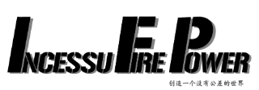
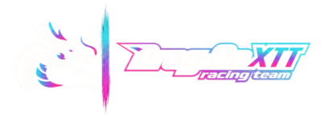
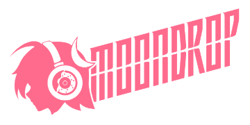

# 小小领航员 LittleNavigator

🏁 给 iRacing 中文玩家的语音助手与 Spotter 语音包。按住按钮说话，松开后听回答，让注意力留在赛道。

Windows 10 2004+ / Windows 11 x64 · 本地规则问答无需 API Key · [源码 MIT](LICENSE)

[⬇️ 下载最新版](https://github.com/xxushengcchen/LittleNavigator/releases/latest) · [快速开始](#三步开始使用) · [使用指南](docs/guide/v1.4.5-interface.md) · [反馈问题](https://github.com/xxushengcchen/LittleNavigator/issues)

<p>
  <picture>
    <source media="(prefers-color-scheme: dark)" srcset="assets/readme/ifp-wargame-dark.png">
    
  </picture>
  &nbsp;
  <picture>
    <source media="(prefers-color-scheme: dark)" srcset="assets/readme/moondrop-dark.png">
    
  </picture>
  &nbsp;
  <picture>
    
  </picture>
</p>

🤝 赞助支持：**IFP Wargame、MoonDrop**；车队：**Drag-On XTT**。感谢他们对项目的支持。

## 开车时，直接开口问

- 🎙️ **少找一次黑框。** 查询油量、剩余时间、名次、圈速和前后车信息，再用中文语音回答。
- **日常问答留在本机。** 本地语音识别、规则匹配与录音播报，不要求接入大模型或语音服务。
- **需要时再扩展。** AI 分析、AI 回答的语音合成（TTS）、语音进站控制分别启用，默认关闭。
- **语音包也能独立使用。** 只安装中文 Spotter，由 iRacing 触发原有播报，不必启动助手。

## 三步开始使用

1. 在 [Releases](https://github.com/xxushengcchen/LittleNavigator/releases/latest) 下载最新 Windows 安装包（文件名以 `Setup-x64.exe` 结尾）并安装，**无需安装 Python**。
2. 打开软件，在「语音输入」选择麦克风，采集键盘或方向盘上的说话键，然后开启监听。
3. 进入 iRacing，按住绑定键说「还剩多少时间」，松开后等待回答。

当前正式版为 [v1.4.5](https://github.com/xxushengcchen/LittleNavigator/releases/tag/v1.4.5)，包含完整本地识别模型与语音。更新内容见 [版本说明](docs/releases/v1.4.5.md)。

<details>
<summary>不开游戏试用、升级与安装问题</summary>

在安装目录打开 PowerShell，可用模拟数据启动；界面会明确标记模拟模式：

```powershell
& ".\小小领航员.exe" --sim
```

系统缺少 WebView2 时，安装包中的微软官方引导器需要联网补装。项目安装包未代码签名，下载页附 `SHA256SUMS.txt`，用于核对安装文件。

升级前退出软件，使用与旧版相同的安装范围和目录。安装版配置、日志和状态位于 `%LOCALAPPDATA%\LittleNavigator`，升级和卸载都会保留。旧便携版可在首次启动安装版前，把 `config.local.yaml` 复制到这个目录。

</details>

## 可以这样问

| 想了解什么 | 试着说 |
| --- | --- |
| 燃油与续航 | 油还够吗；目前还有多少油；每圈油耗多少 |
| 比赛进度 | 还剩多少时间；比赛还剩几圈；我已经跑完几圈 |
| 自己与对手的圈速 | 我上一圈多少；最佳圈速多少；前车上一圈多少 |
| 位置与前后车 | 现在第几名；同组第几名；前车多远；后车多远 |
| 维修与天气 | 还剩几次快修；必修还剩多久；气温多少；路面温度多少 |
| 进站服务，需先启用 | 帮我取消换胎；只换左侧轮胎；帮我加10升油；勾上快修 |

一次询问一个具体项目。全场第一名、赛道前后车与自己的车辆是不同对象；普通圈速问题默认读取上一完整圈。

## 实际软件界面


上图来自真实软件，遥测使用明确标记的模拟数据。进站示意图只读显示游戏服务勾选；断线后会清空旧遥测。

[查看完整界面指南](docs/guide/v1.4.5-interface.md)，了解麦克风、耳机路由、文字试问和问答记录的使用方法。

## 按需开启 AI 与进站控制

不配置以下功能，也能使用本地规则问答与中文录音播报。

- **AI 分析：** 在「AI 工程师」填写模型接口、模型名和自己的 API Key，通过兼容 Chat Completions 的接口调用，费用由所接服务决定。
- **AI 回答语音合成：** 在同页的 TTS 区域单独配置与保存；不配置时 AI 只有文字，不影响规则问题的录音播报。
- **语音进站控制：** 在「进站控制」单独启用并保存，可设置换胎、加油、快修、清洁挡风，或取消、清空进站服务。

⚠️ **语音进站控制会改变游戏中的进站设置。** 语音可能识别错误，请先在练习赛核对软件读回与游戏黑框。当前加油只执行整数升数，小数明确拒绝；轮胎配方、刹车平衡、TC/ABS 档位、雨刷和方向盘不支持语音修改。

## 语音包单独装进 iRacing

只想换中文 Spotter，可在 [v1.4.1 发布附件](https://github.com/xxushengcchen/LittleNavigator/releases/tag/v1.4.1) 下载 `LittleNavigator-iRacing-VoicePack-v1.4.1.zip`。已安装助手时，也可使用安装目录下的 `build\pack\Mandarin-CNTW-Xusheng_Chen`。

退出模拟器，将 `Mandarin-CNTW-Xusheng_Chen` 文件夹复制到 **iRacing 游戏安装目录**的 `sound\spcc`，在游戏 **Options → Sound → Voice Pack** 中选择它，再重新加载模拟器。

[完整安装步骤与目录示例](docs/guide/spotter-install.md)。注意使用游戏安装目录，通常不是「文档\iRacing」。

## 使用前了解

- 规则问答依赖短语和意图匹配。AI 为可选补充，目前是一问一答，不支持多轮追问或主动工程师提醒。
- 没有可靠遥测时会说明读不到；事故点不能用来判断具体车损，也不能用秒差代替圈差。
- 前后车秒差是估计值；冷胎压是设定值，胎温和磨损来自有效进站检测，不能当作持续更新的胎面数据。
- 支持的字段与赛车有关。真实麦克风、方向盘、AI/TTS 接口和比赛场景仍需要在实际使用中验证。

更多数据范围、操作边界与后续计划见 [能力与限制](docs/guide/capabilities-and-limits.md)。

## 开发和参与

💬 欢迎补充真实问法、报告播报问题、测试车型与方向盘，或提交代码。反馈时请附版本、车型、赛道、原话、识别文字和预期结果；只提供相关日志片段，**不要上传 API Key 或完整私人日志**。

[贡献指南](CONTRIBUTING.md) · [开发与构建](DEVELOPMENT.md) · [真机问题修复记录](docs/live-race-fixes.md)

主要代码在 [`voice-assistant/`](voice-assistant/)：`src/` 负责识别、遥测、问答和播放，`app/` 是桌面窗口与界面，`tests/` 为回归测试，`packaging/` 负责打包。语音文案与生成工具位于 `content/`、`scripts/`。

## 许可与致谢

程序源代码采用 [MIT License](LICENSE)。预训练模型、第三方依赖、品牌标识与语音资源保留各自来源和使用条件，详见 [素材与依赖说明](THIRD_PARTY_NOTICES.md)。


**MoonDrop 五款标识**

<p>
  <picture>
    <source media="(prefers-color-scheme: dark)" srcset="assets/readme/moondrop-dark.png">
    
  </picture>
  &nbsp;
  <picture>
    <source media="(prefers-color-scheme: dark)" srcset="assets/readme/moondrop-racing-dark.png">
    
  </picture>
  &nbsp;
  <picture>
    <source media="(prefers-color-scheme: dark)" srcset="assets/readme/moondrop-signature-dark.png">
    
  </picture>
  &nbsp;
  <picture>
    
  </picture>
  &nbsp;
  <picture>
    <source media="(prefers-color-scheme: dark)" srcset="assets/readme/moondrop-symbol-dark.png">
    
  </picture>
</p>

制作：xushengchen from Moondrop-Dox Racing。感谢 IFP Wargame、MoonDrop 的赞助支持，以及 Drag-On XTT 车队的支持。项目由社区维护，**不是 iRacing 官方软件**。
