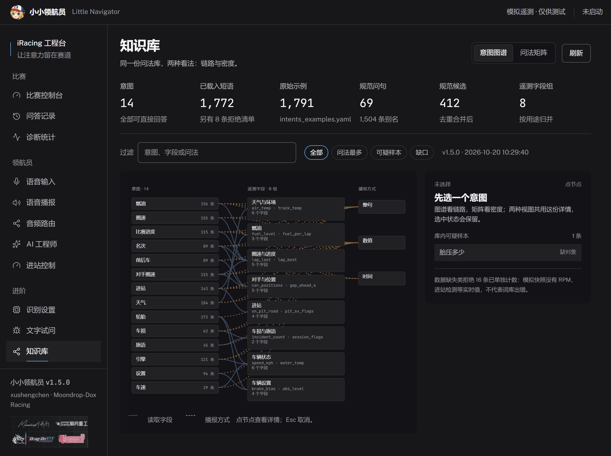
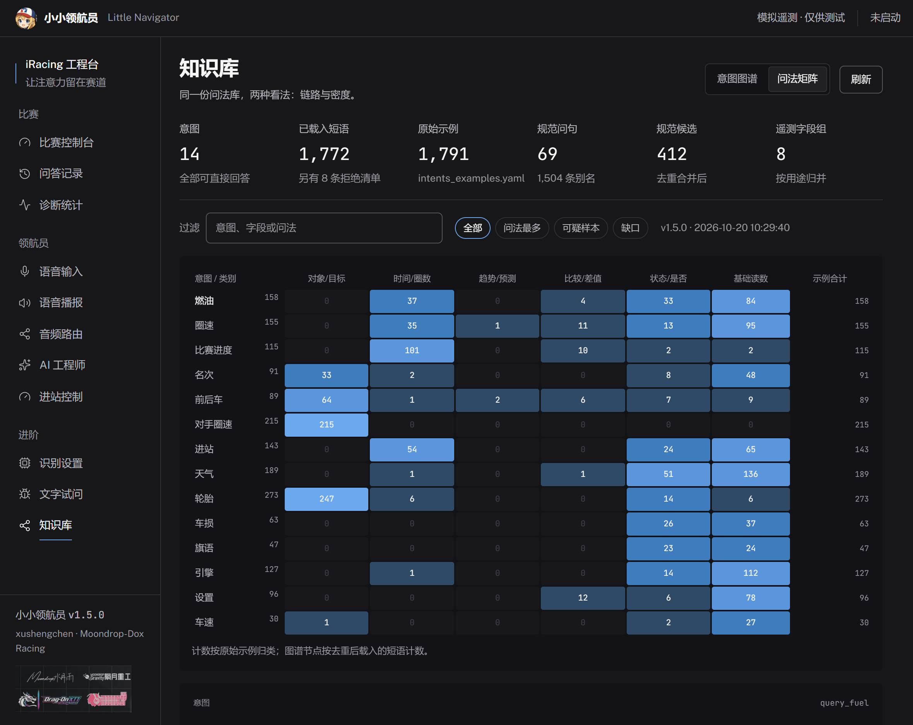
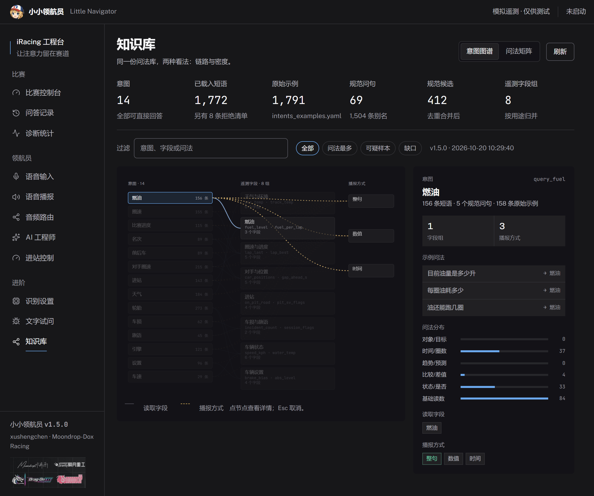

# 小小领航员 使用指南

适用于 **v1.5.2** Windows 桌面版。从安装到日常使用，覆盖十一个页面、常用问法、可选的 AI 与语音改车、文件位置和排错。

顺序按「装上 → 说话 → 听见 → 按需扩展」排。只想尽快跑起来，读第 1、2 节就够；遇到问题直接看第 9 节。

[安装与启动](#1-安装与启动) · [首次设置](#2-首次设置能说话能听见) · [十一个页面](#3-十一个页面) · [怎么问](#4-怎么问) · [AI 与语音合成](#5-可选接入-ai-与语音合成) · [语音改车](#6-可选语音改车) · [语音包](#7-单独安装中文-spotter-语音包) · [文件位置](#8-文件与数据位置) · [排错](#9-排错) · [能力边界](#10-能力边界)

## 1 安装与启动

### 系统要求

| 项目 | 要求 |
| --- | --- |
| 系统 | Windows 10 2004 及以上，或 Windows 11，64 位 |
| 运行库 | Microsoft Edge WebView2 Runtime |
| Python | 不需要。本地识别模型和中文语音随安装包提供 |
| 游戏 | 可选。不开 iRacing 时可用 `--sim` 模拟数据试用界面 |

Windows 11 通常已自带 WebView2；Windows 10 若缺少，安装程序会调用微软官方引导器联网补装。全程离线安装需要提前手动装好 WebView2 运行时。

### 下载与校验

在 [Releases](https://github.com/xxushengcchen/LittleNavigator/releases/latest) 页面下载文件名以 `Setup-x64.exe` 结尾的安装包（v1.5.2 约 307 MiB，含完整本地模型与语音）。同一版本页面附 `SHA256SUMS.txt`，可在意完整性时核对：

```powershell
Get-FileHash .\LittleNavigator-1.5.2-Setup-x64.exe -Algorithm SHA256
```

安装包**未做代码签名**，Windows SmartScreen 可能提示「未知发布者」，需要手动选择仍要运行。

### 安装

1. 双击安装包，按向导下一步。
2. 选择安装范围：默认按当前用户安装，不需要管理员权限；也可以在向导里改为所有用户。
3. 确认安装目录（可改）。
4. 完成后从开始菜单或桌面快捷方式启动。

| 安装范围 | 默认目录 |
| --- | --- |
| 当前用户（默认） | `%LOCALAPPDATA%\Programs\LittleNavigator` |
| 所有用户 | `C:\Program Files\LittleNavigator` |

用户配置、日志与状态**不放在安装目录**，而在 `%LOCALAPPDATA%\LittleNavigator`（见[第 8 节](#8-文件与数据位置)）。

### 启动

双击「小小领航员.exe」打开原生窗口。右上角 `−` 最小化、`×` 退出。关闭窗口即结束程序，不会留在托盘后台。

窗口默认 1180×820，最小 900×650，可以拖动边缘调整大小。

### 命令行参数（进阶，可选）

在安装目录打开 PowerShell 后使用：

| 参数 | 作用 |
| --- | --- |
| `--sim` | 使用明确标记的模拟遥测，界面会显示「模拟模式」 |
| `--sim-advance` | 配合 `--sim`，让模拟数据随时间推进圈数 |
| `--port 8788` | 更换本地接口端口（默认 8770） |
| `--config <路径>` | 指定配置文件 |
| `--no-listen` | 启动时不自动开启 PTT 监听 |
| `--no-window` | 不打开窗口，只跑服务 |
| `--window-smoke-test` | 创建一次真实窗口验证 WebView2，然后自动退出 |
| `--overlay-smoke-test` | 创建主窗口与游戏内 Overlay，验证样式/透明度后自动退出 |

```powershell
& ".\小小领航员.exe" --sim
```

### 升级与卸载

- **升级前先退出软件**，再用与旧版相同的安装范围装到同一目录。
- 用户配置、日志和状态在 `%LOCALAPPDATA%\LittleNavigator`，升级与卸载都会保留。
- 卸载在「设置 → 应用 → 已安装的应用」里进行。要彻底清除，卸载后手动删除上面那个目录。
- 从旧便携版转到安装版：先把旧目录里的 `config.local.yaml` 和 `state\cooldown.json` 复制到 `%LOCALAPPDATA%\LittleNavigator`。

## 2 首次设置：能说话、能听见

三件事配好就能用，全部**改完自动保存**，页面会显示保存结果。

1. **选麦克风。** 进「语音输入」，在麦克风下拉里试几个设备，选能读到电平的那个。
2. **绑说话键。** 同页的按键采集区点一下，然后按键盘或方向盘上想用的键。设置误触阈值可过滤轻碰。
3. **确认能听见。** 「语音播报」调音量并试听；「音频路由」选定耳机输出，并决定播报时是否压低游戏音量。

回到「比赛控制台」，状态栏会分别报告游戏、麦克风、AI 与进站控制四项。**某项未启用不影响其他功能**：没连游戏时规则问答照样能回答「这一圈多少秒」以外的静态问题，没配 AI 时本地问答和录音播报照常工作。

点「开启监听」后，按住绑定键说话、松开等待回答；再点一次「暂停监听」停止。

## 3 十一个页面

左侧导航分三组：**比赛**、**领航员**、**进阶**。

| 页面 | 分组 | 做什么 | 保存方式 |
| --- | --- | --- | --- |
| 比赛控制台 | 比赛 | 连接状态、最近回答、核心遥测、进站服务读回 | 只读 |
| 问答记录 | 比赛 | 提问、回答与执行结果；可导出日志 | 只读 |
| 诊断统计 | 比赛 | 命中路径分布、首包延迟、未命中问法 | 只读 |
| 语音输入 | 领航员 | 识别模型、麦克风、说话键、误触阈值 | 自动保存 |
| 语音播报 | 领航员 | 音量、变体冷却、试听 | 自动保存 |
| 音频路由 | 领航员 | 输出设备与游戏音量压低 | 自动保存 |
| AI 工程师 | 领航员 | 模型、语音合成与等待语音、分析键、Overlay、赛后复盘 | 每区单独保存 |
| 进站控制 | 领航员 | 允许语音改车、执行回读、只读服务示意图 | 单独保存 |
| 识别设置 | 进阶 | 严格语音模式与识别边界 | 自动保存 |
| 文字试问 | 进阶 | 先预览解析，再决定是否执行和播报 | 不保存 |
| 知识库 | 进阶 | 短语、意图与字段的链路图与密度矩阵 | 只读 |

### 比赛控制台

驾驶时最常看的一页：连接状态、最近一次回答、油量 / 名次 / 后车差距 / 上一圈四项遥测，以及下次进站服务的读回。

- 断线后**清空旧遥测**，避免用过期数字做判断。
- `—` 表示未读到，`0` 是真实的零值，两者不会混用。
- 进站服务的四轮示意图只是读回，**不可点击改车**。
- 右上角「文字试问 ↗」直接跳到调试页。

### 问答记录

按时间倒序显示每次提问、回答与执行结果，AI 回答正文也会显示。反馈问题时可点「导出日志」拿到打包好的记录。

### 诊断统计

用来看问题出在哪一环：实际命中的路径分布、首包延迟直方图、未命中的问法列表。识别错、匹配错还是播放慢，看这一页最快。

### 语音输入

识别模型与线程数、麦克风选择、PTT 绑定、误触阈值。改动自动保存。

### 语音播报

音量、变体冷却（同一句话两次播报的最短间隔）与试听。不想在某句话上反复听到同一段录音时调冷却。

### 音频路由

指定播报从哪个耳机输出，以及播报时是否压低游戏音量。

### AI 工程师

页面上有五个可保存的区域：模型接入、语音合成（含等待语音）、专用分析键、学习库维护、游戏内 Overlay；下方还有本场 AI 问答的赛后复盘列表。**每个区域单独保存**，保存一组不会丢掉另一组的草稿；草稿只在当前窗口内保留，关掉程序不保存。详见[第 5 节](#5-可选接入-ai-与语音合成)。

### 进站控制

语音改车的总开关（默认关闭）、执行回读与只读服务示意图。详见[第 6 节](#6-可选语音改车)。

### 识别设置

严格语音模式与识别边界。严格模式下只接受明确匹配的问法，减少误触发；代价是生僻说法更容易被拒。

### 文字试问

不开口也能验证一句话的去向，推荐在第一次用、或想确认某个说法时用：

1. 输入一句话，点 **预览解析**。会显示命中的意图、读取的字段和将要播报的内容。
2. 确认无误后点 **执行并播报**。

预览**不调用模型、不改车、不播音**。操作类问法（如「帮我取消换胎」）在执行时才真正改变进站设置，按钮上会明确提示。一旦编辑输入框，旧的预览结果立即失效，迟到的预览不会覆盖新输入。

### 知识库

v1.5.0 新增的只读诊断页面，把「问法 → 意图 → 遥测字段 → 播报方式」整条链路摊开。两种看法：

**意图图谱** —— 左侧意图、中间遥测字段组、右侧播报方式，连线表示这条链路实际会走到哪。



**问法矩阵** —— 14 个意图 × 6 类问法语义的数量矩阵，用深浅表示密度，能看出哪类问法多、哪里还是空的。



点节点或格子后，右侧详情给出示例问法、问法分布、读取字段和播报方式；选中状态在两种模式间保留，按 **Esc** 取消选择。



几点约定：

- 页面**只读**：不播报、不改车、不调模型、不改短语库。
- 顶部筛选条可按「全部 / 问法最多 / 可疑样本 / 缺口」过滤，也能用输入框搜意图、字段或问法。
- **可疑样本**是规则层面的问题，例如两条意图同时接受同一句话、或问法缺必要对象（如「胎压多少」没说哪个轮）。
- **数据缺口**单独计数，不当成缺陷：那是游戏端本来读不到的值，模拟快照里自然也没有。
- 计数口径不同：图谱节点按去重后载入的短语计数，矩阵按原始示例归类，所以同一意图在两处可能差几条。

数据全部在请求时从 `intents_examples.yaml`、真实短语匹配器、规范问句表和路由代码现算，没有第二份清单，因此改词库后刷新就看到新结果。设计与已知边界见 [知识库文档](../knowledge-base.md)。

## 4 怎么问

| 想了解什么 | 试着说 |
| --- | --- |
| 燃油与续航 | 油还够吗；目前还有多少油；每圈油耗多少 |
| 比赛进度 | 还剩多少时间；比赛还剩几圈；我已经跑完几圈 |
| 自己与对手的圈速 | 我上一圈多少；最佳圈速多少；前车上一圈多少 |
| 位置与前后车 | 现在第几名；同组第几名；前车多远；后车多远 |
| 车辆状态 | 现在几档；水温多少；车速多少 |
| 维修与天气 | 还剩几次快修；必修还剩多久；气温多少；路面温度多少 |
| 进站服务（需先启用） | 帮我取消换胎；只换左侧轮胎；帮我加10升油；勾上快修 |

几条使用习惯：

- **一次问一个具体项目。** 一句话里塞两个问题只会答一个。
- **全场第一名、赛道上的前后车、自己的车是三个不同对象**，说法要区分开。
- 普通圈速问题默认读取**上一个完整圈**。
- 问法不需要问号。「我是否需要快修」按咨询处理，「快修」单独说是操作口令。
- 拉丁词和同音错字也能匹配：`abs 几档`、`tc 几档` 走车辆设置，`现在几档` 走引擎；「油还購吗」这类同音错字仍能命中。
- 想知道某句话会怎么被理解，用「文字试问」的预览，不要靠猜。

## 5 可选：接入 AI 与语音合成

**默认全部关闭。** 不配置这两项，本地规则问答和中文录音播报完全可用，也不需要任何 API Key。

两项服务要不要分开理解：

| 想达到的效果 | 需要配 | 费用 |
| --- | --- | --- |
| 让 AI 生成一段分析文字 | 模型 API（如 DeepSeek） | 由模型服务商计费 |
| 让 AI 的回答能被念出来 | 语音合成 API（如豆包语音） | 由语音服务商计费 |
| 本地规则问答 + 中文录音播报 | 什么都不用配 | 免费、离线 |

申请密钥的分步说明在首页 [获取 API：以 DeepSeek 和豆包语音为例](../../README.md#获取-api以-deepseek-和豆包语音为例)，字段对应和原理见 [API 接入指南](api-setup.md)。要点：

1. **模型 Key 和语音 Key 分开填。** 不要混用，也不要把火山方舟的模型 Key 或云账号 AK/SK 填进语音合成。
2. 填完先点 **保存模型设置 → 测试连接**，再单独配置语音合成并 **保存语音合成 → 试听**。
3. 「试听」只报告合成是否成功、音频大小与耗时，**不会播放声音**。要确认耳机真的出声，请用一个分析类问题走完整的「执行并播报」。
4. 文字试问里只点「预览解析」不会调用模型，要点「执行并播报」。

### 「响应方式」怎么选

填好模型后，「响应方式」决定哪些话交给模型：

| 档位 | 交给模型的内容 | 适合谁 |
| --- | --- | --- |
| 白名单（推荐） | 分析类问题，以及你自己加入白名单的问法 | 大多数用户，省时省钱 |
| 分析键触发 | 按住专用分析键提的问题 | 想完全手动控制 |
| 规则答不上就接管 | 规则答不上来的问题 | 尽量别听到「答不了」 |
| 全部交给 AI | 除安全、处罚、改车外的所有问题 | 想要最自然的回答 |

「全部交给 AI」连本地规则答得上的问题也交给模型，回答更像真人，代价是每次多等一点、多花一点模型费用。无论选哪一档，**安全与处罚话题、语音改车指令都只走本地规则**，不会交给模型。

页面上方还有一个更直接的**「全局交给 AI」开关**：打开后不用再选档位，所有问答只走 AI，本地规则和本地拒绝语都不再出声；安全、处罚、改车仍由本地判定，但只显示文字。关掉开关会回到你原来的档位。注意：只开这个开关、不配语音合成时，AI 回答只有文字。

### 思考模式

模型接入区新增**「关闭思考模式」**，默认关闭思考，优先速度。

- 关闭时：DeepSeek 不再思考；OpenAI 系列不加推理参数。
- 不关闭时：使用最低思考强度（DeepSeek / OpenAI 均为 low），比默认高强度快。
- 其他兼容服务商是否支持由对方决定，界面开关仍会显示。

### 等待语音

AI 思考时会先播一句约 1 秒的等待语（共 20 条，一轮内不重复），避免干等无声。开关和语音合成放在一起：默认开启，觉得吵或想少等一句可以关掉。等待语播放的是随安装包提供的中文语音，不需要额外的语音服务。v1.5.2 重新录制并补了句末标点，每条都会完整播完。语音合成区的「测试」现在会真的播放试听音。

### 游戏内 Overlay

把「听到的语音」和最近一次回答叠在游戏画面上，开车时不用切回主窗口。

- **开启方式：** 在「AI 工程师」页展开「游戏内 Overlay」，选择开启并保存；保存后立即生效，不用重启。默认关闭。
- **不挡操作：** 窗口无边框、置顶、点击穿透，不抢鼠标和键盘；游戏里按 **Ctrl+Alt+O** 可以临时显示或隐藏（不写入配置）。
- **外观：** 透明度 20%–100%（默认 85%），显示位置可选左上、右上、左下、右下四角；多屏时以主屏为准。v1.5.2 起边框贴合文字，识别、状态、回答统一 14 像素。
- **自由摆放：** 游戏里按 **Ctrl+Alt+L** 进入布局模式（暂时关闭点击穿透），拖动卡片移动、拖右下角缩放；再按一次恢复穿透并保存位置与大小。主界面的 Overlay 设置里也能直接填宽高、X/Y 坐标，或一键恢复默认。
- **显示内容：** 识别到的原话和最近一次回答；AI 思考时显示状态，出错时显示原因。只开 Overlay 也能用，本地规则回答同样会显示。
- **关闭：** 在同一个设置块里改回「关闭」并保存。

AI 回答有超时、长度和数值来源检查；遥测数据在生成过程中发生变化或读不到时，程序会拒答而不是播报过期数字。

## 6 可选：语音改车

**默认关闭。** 在「进站控制」启用并保存后，才接受改车口令。

支持的语句：

- 换胎：`帮我换胎`、`只换左侧轮胎`、`换四个轮胎`、`取消换胎`
- 加油：`帮我加10升油`、`加满`、`取消加油`
- 快修：`勾上快修`、`取消快修`
- 挡风清洁：`清洁挡风`、`关闭挡风清洁`
- 清空：`清空进站服务`

明确不支持：轮胎配方、刹车平衡、TC/ABS 档位、雨刷、方向盘操作。

几条硬约束：

- **加油只发送整数升数。** 说「加 1.5 升」会被明确拒绝，不会静默取整。
- 每次操作后都会读回游戏状态核对，失败会给出明确错误而不是假装成功。
- 部分换胎会先清空四胎再勾选目标，避免残留上一次的勾选。
- **语音可能识别错误。** 第一次使用请在练习赛里逐条核对软件的读回和游戏黑框上的实际设置。

## 7 单独安装中文 Spotter 语音包

只想换中文 Spotter、不需要助手界面也可以装：

1. 在 [v1.4.1 发布附件](https://github.com/xxushengcchen/LittleNavigator/releases/tag/v1.4.1) 下载 `LittleNavigator-iRacing-VoicePack-v1.4.1.zip`；已安装助手的话，直接用安装目录下的 `build\pack\Mandarin-CNTW-Xusheng_Chen`。
2. 退出模拟器。
3. 把 `Mandarin-CNTW-Xusheng_Chen` 文件夹复制到 **iRacing 游戏安装目录**的 `sound\spcc`。
4. 在游戏里打开 **Options → Sound → Voice Pack**，选中它。
5. 重新加载模拟器生效。

注意是**游戏安装目录**，通常不是「文档\iRacing」。完整目录示例见 [Spotter 安装说明](spotter-install.md)。

## 8 文件与数据位置

| 内容 | 安装版 | 便携版 |
| --- | --- | --- |
| 用户配置覆盖 | `%LOCALAPPDATA%\LittleNavigator\config.local.yaml` | 程序目录 |
| 日志 | `%LOCALAPPDATA%\LittleNavigator\logs\` | 程序目录 |
| 冷却与状态 | `%LOCALAPPDATA%\LittleNavigator\state\` | 程序目录 |
| 短语库 | `<安装目录>\intents_examples.yaml` | 同左 |
| 本地识别模型 | `<安装目录>\models\` | 同左 |
| 语音包 | `<安装目录>\build\pack\` | 同左 |
| 使用说明 | `<安装目录>\使用说明.txt` | 同左 |

- 环境变量 `LITTLE_NAVIGATOR_DATA_DIR` 可以把用户数据目录换到别处，值必须是绝对路径。
- `intents_examples.yaml` 是短语库，加词改这份；改完在「知识库」点刷新即可看到新统计。
- 反馈问题时只附你确认过的片段，**不要上传 API Key 或完整私人日志**。

## 9 排错

| 现象 | 先检查 |
| --- | --- |
| 状态栏显示未连接游戏 | iRacing 是否在跑；是否在赛道内（不是菜单）；SDK 是否被其他软件占用 |
| 说话没反应 | 「语音输入」里麦克风是否选对；Windows 麦克风权限是否放开；绑定键是否被其他软件抢走 |
| 有回答但没声音 | 「音频路由」的输出设备；「语音播报」的音量；试听是否成功 |
| 声音从音箱出而不是耳机 | 「音频路由」里显式选择耳机设备，不要用系统默认 |
| AI 报鉴权失败 | 模型 Key 是否正确、是否属于该服务商；接口地址是否只填到域名 |
| AI 报额度或权限错误 | 服务商控制台里余额、服务开通状态、音色所属项目 |
| AI 有文字但没声音 | TTS 是否已单独保存；试听是否成功；耳机路由是否正确 |
| 「试听」成功却听不到 | 试听只报告合成结果、不播放声音，请用「执行并播报」验证实际出声 |
| AI 思考时没有等待语 | 「语音合成」里的等待语音是否开启；语音包是否完整 |
| 游戏里看不到 Overlay | 「AI 工程师」里 Overlay 是否开启并保存；是否用 `--no-window` 启动；Ctrl+Alt+O 是否被其他软件占用 |
| 语音改车没生效 | 「进站控制」是否启用并保存；是否在练习赛而不是回放；游戏是否允许该操作 |
| 安装时提示缺少 WebView2 | 联网重跑安装，或手动安装 Microsoft Edge WebView2 Runtime 后重试 |
| 程序打不开或白屏 | 先运行 `小小领航员.exe --window-smoke-test` 看是否能创建窗口；检查 WebView2 运行时 |

排查时优先看「诊断统计」和「问答记录」：前者说明命中了哪条路径，后者留着原话和结果。提交 issue 时附版本、车型、赛道、原话、识别文字和预期结果。

## 10 能力边界

这些是当前版本真实存在的限制，不是待办清单：

- **一次一问。** 不支持多轮追问，也不能主动提醒你该进站了。
- **事故点不能判断具体车损**，也不存在这种数据来源。
- 前后车秒差是**估计值**；冷胎压是设定值；胎温和磨损来自有效进站检测，不是持续更新的胎面数据。
- 没有可靠圈差时**不会用秒差冒充**，读不到就说明读不到。
- 支持的字段与车型有关（不同赛车暴露的遥测字段不同）。
- 语音改车不支持轮胎配方、刹车平衡、TC/ABS、雨刷和方向盘。
- 真实麦克风、方向盘按钮、外部 AI/TTS 接口和实际比赛场景的稳定性仍需要用户在实际使用中验证；离线测试不能替代这些链路。

更细的数据范围与操作边界见 [能力与限制](capabilities-and-limits.md)，真机问题记录见 [真机修复记录](../live-race-fixes.md)。

## 11 反馈与许可

💬 欢迎补充真实问法、报告播报问题、测试车型与方向盘。反馈时请附版本、车型、赛道、原话、识别文字和预期结果。

- [提交问题](https://github.com/xxushengcchen/LittleNavigator/issues)
- [贡献指南](../../CONTRIBUTING.md)
- [开发与构建](../../DEVELOPMENT.md)
- [素材与依赖说明](../../THIRD_PARTY_NOTICES.md)
- [版本说明](../releases/v1.5.2.md)

程序源代码采用 [MIT License](../../LICENSE)。预训练模型、第三方依赖、品牌标识与语音资源保留各自来源和使用条件。

项目由社区维护，**不是 iRacing 官方软件**。
