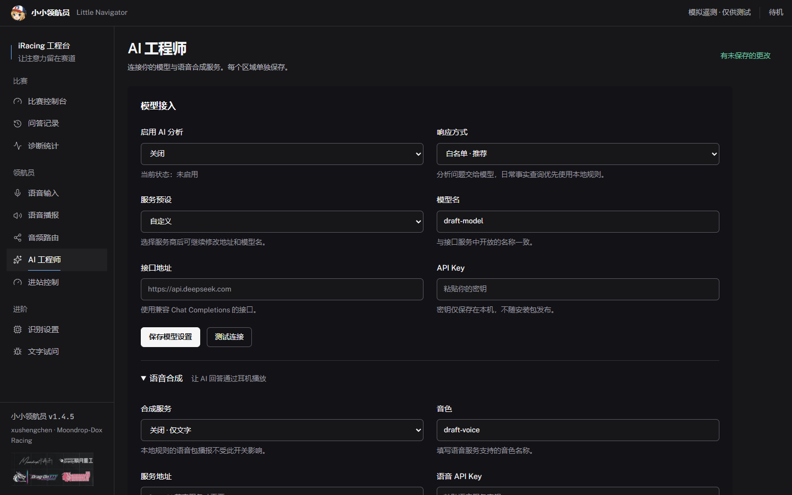
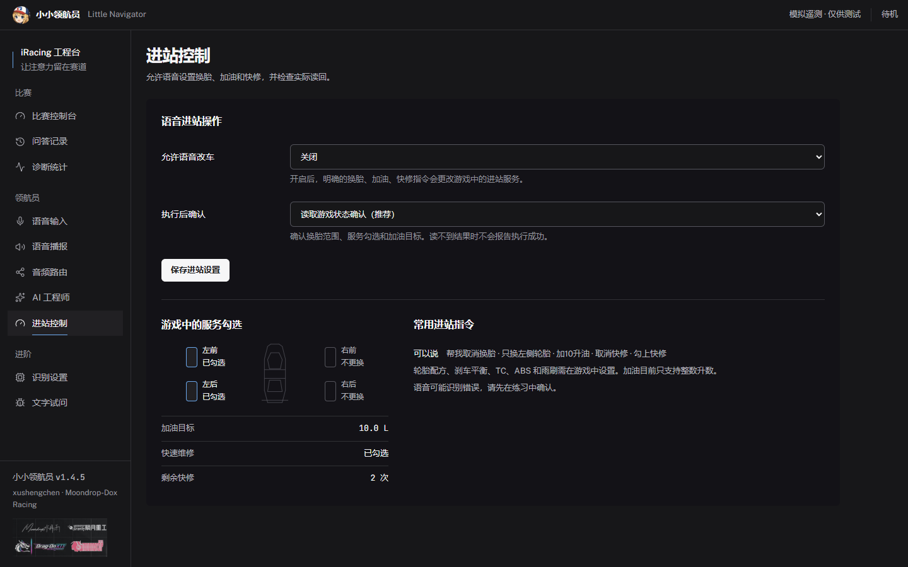

# 用新版工程台准备一次比赛

v1.4.5 把驾驶前的配置和比赛中的检查拆开。先在左侧完成麦克风、耳机与可选接口设置，再回到“比赛控制台”检查连接和最近回答。

## 先确认能说话、能听见

在“语音输入”选择麦克风，采集键盘或方向盘上的说话键。在“语音播报”调音量并试听，在“音频路由”确认耳机输出。标注自动保存的页面修改后会显示保存结果；失败会保留输入并提示原因。

回到控制台开启监听，按住绑定键说话，松开后等待回答。状态栏分别报告游戏、麦克风、AI 与进站控制；某项未启用不代表其他功能不能使用。

## 需要 AI 时单独接入

在“AI 工程师”填写模型接口，保存并测试连接。TTS 折叠区单独保存；未配 TTS 的 AI 回答只有文字。本地规则问答无需 API Key。

首次申请密钥可按 [首页的 DeepSeek 与豆包语音步骤](../../README.md#获取-api以-deepseek-和豆包语音为例) 操作，字段对应与错误排查见 [API 接入指南](api-setup.md)。模型 Key 与语音 Key 分开填写；v1.4.5 的 DeepSeek 旧预设名需要按官方当前文档手动更新。

模型、TTS、分析键的草稿在当前窗口内切换页面时保留，保存一组不会丢掉另一组的草稿。退出程序前仍需分别保存；草稿不会写入浏览器 localStorage。

## 检查下次进站

“进站控制”单独启用语音改车。服务图只读反映游戏勾选，左前/右前/左后/右后分别显示，旁边是加油目标和快修状态。断线后显示未读到，不能用旧勾选判断下次服务。

明确说“帮我取消换胎”“只换左侧轮胎”“帮我加10升油”“取消快修”“勾上快修”。“我是否需要快修”按咨询处理，不要求语音识别输出问号；“快修”本身仍是操作快捷口令。当前只支持整数升数，1.5 升等请求会明确拒绝。

## 用文字试问排查一句话

“预览解析”只展示识别路径，不调用模型、不播音、不改车。确认文字后点“执行并播报”；操作指令会明确提示更改进站设置。改过文字后需要重新预览，旧结果不会继续执行。实际效果还要核对游戏黑框和软件读回。

“问答记录”可回看规则与 AI 答案，“诊断统计”显示实际延迟和未命中问法。反馈时提供版本、原话、识别文字和预期结果，避免上传凭据或完整私人日志。

截图全部来自标明模拟状态的测试夹具。布局和交互已通过浏览器测试；真实麦克风、比赛及外部 AI/TTS 仍需要实际使用验证。

[版本说明](../releases/v1.4.5.md) · [下载 v1.4.5](https://github.com/xxushengcchen/LittleNavigator/releases/tag/v1.4.5) · [项目说明](../../README.md)
