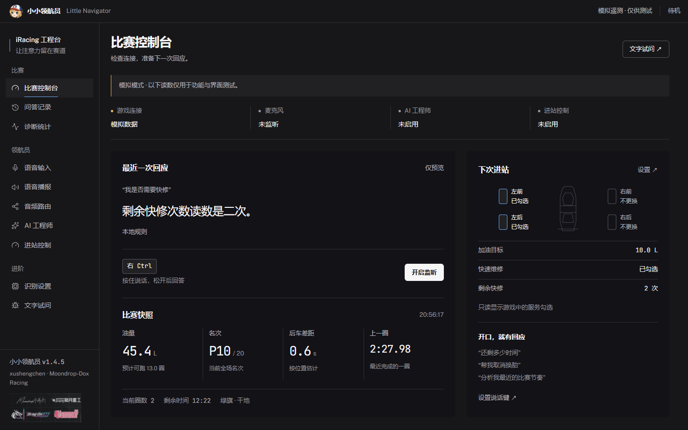

# 小小领航员 v1.4.5

全部十个界面重新设计为深色比赛工程台：连接状态、最近回答、关键遥测与下次进站服务可以在一个控制台检查。AI 接入和进站操作分开配置，文字试问先预览，再明确执行。

[下载安装包](https://github.com/xxushengcchen/LittleNavigator/releases/tag/v1.4.5) · [新版界面指南](../guide/v1.4.5-interface.md) · [v1.4.4…v1.4.5 代码比较](https://github.com/xxushengcchen/LittleNavigator/compare/v1.4.4...v1.4.5)

## 完整界面更新

- 带文字的分组导航、原生可调整窗口、窄屏抽屉、本地字体、键盘焦点与减少动态支持。
- 控制台显示真实 API 的连接和问答状态；遥测缺失显示 —，0 保留为零值，断线清空旧遥测。
- 四轮示意图只读显示 `PitSvFlags`，并列显示加油目标、快修勾选和剩余次数。
- AI 模型、TTS 与分析键分区保存；未保存内容在当前窗口内跨页保留，关闭窗口后不保留。不会把密钥草稿写进浏览器本地存储。
- 问答记录可显示 AI 正文；统计图使用实际分布，计数轴保持整数。错误提示保留输入并可重试。
- 文字试问预览不调用模型、不改车、不播音；执行按钮明确提示操作影响。编辑文字会使旧执行结果失效，迟到的预览不能覆盖新输入。

## 合入比赛问题修复

- 改车控制器独立建立 SDK 连接，支持掉线重连；状态轮询不发广播，失败操作不自动重放。
- 部分换胎先清除四胎，再勾选目标；核对完整轮胎掩码。取消服务核对对应位熄灭，加油还核对实际目标升数。
- 咨询与操作按无标点语义区分，如“我是否需要快修”；单独“快修”“撕膜”仍是操作快捷口令。
- 加油只执行整数升数，小数明确拒绝。圈差不会用秒差代替，维修计时与自然分析问法修正。
- 文字执行可以转交 AI 并使用配置的 TTS；AI 返回后及出声前检查数据变化，避免播放已过期的动态答案。

历史证据和具体限制见 [真机修复记录](../live-race-fixes.md)。

## 验证与边界

- 后端单元回归：539 项通过。
- Edge 浏览器交互回归：16 组通过，覆盖十页、草稿、错误恢复和六种宽度。
- 1440 / 768 / 390px 真实浏览器设计检查无 FAIL、无未豁免 WARN。静态检查的等宽字体与缺失值占位提示有具体理由，见 [设计记录](../design/v1.4.5-ui.md)。
- 实际打包程序的 WebView2 窗口烟测退出码 0，报告 `loaded:true`；这不等于完成安装、升级和卸载的全周期测试。
- 1,769 条短语自检与 3,153 条音频完整性检查通过；截断问法扫描仍提示两项既有 ABS/TC 潜在误判，没有将其宣称已修复。
- 安装包 316.7 MiB，包含完整本地模型和 3,153 条语音，附 SHA256SUMS.txt。主包 2,496 条均为 16 kHz；助手素材包含 16/24 kHz。

本轮浏览器测试模拟写入，没有调用付费 AI、启动麦克风或发送真实游戏操作。新版的麦克风识别、外部 AI/TTS 和真实比赛持续测试由真实用户继续验证；不能把离线测试当作这些链路已验收。

## 安装与升级

下载 `LittleNavigator-1.4.5-Setup-x64.exe`。升级前退出旧版，选择相同安装范围与目录；用户配置、日志和状态继续保存在 `%LOCALAPPDATA%\LittleNavigator`。AI、TTS、进站控制默认关闭，已有用户配置沿用。

系统缺少 WebView2 时，微软官方引导器需要联网补装。项目安装包未代码签名。
